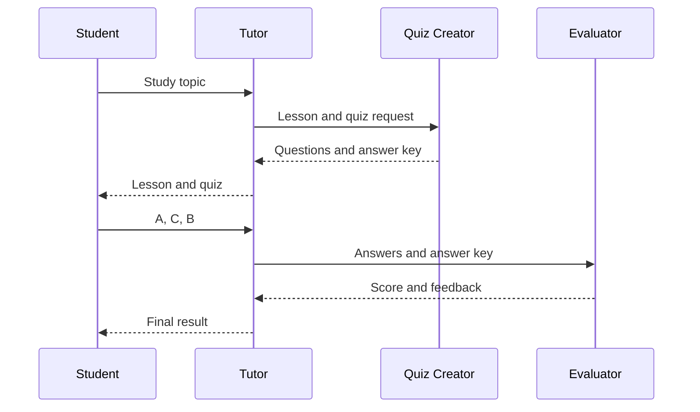

# AI Study Mission — Agentverse Multi-Agent Demo

A lightweight study assistant built with three cooperating
[Agentverse](https://agentverse.ai) Hosted Agents. It teaches a topic, creates
a quiz, grades the learner's answers, and returns personalized feedback.

No database, web server, Docker container, or local runtime is required.

## How it works

1. A learner sends a topic to the **Tutor Agent** through ASI:One.
2. The Tutor generates a beginner-friendly lesson.
3. The Tutor asks the **Quiz Creator Agent** for exactly three questions.
4. The learner submits three choices.
5. The **Evaluator Agent** grades the choices and generates feedback.
6. The Tutor presents the final score to the learner.



## Agent files

- `tutor_agent.py` — public chat interface and workflow coordinator.
- `quiz_creator_agent.py` — creates and validates multiple-choice questions.
- `evaluator_agent.py` — grades deterministically and produces learning
  feedback.

Each file is deployed as the `agent.py` file of a separate Hosted Agent.

## What you need

- An [Agentverse](https://agentverse.ai) account.
- An ASI:One API key from the
  [ASI:One developer portal](https://asi1.ai/developer).
- Three new Agentverse Hosted Agents.

## Build your agents

### 1. Create three Hosted Agents

In Agentverse, create these agents:

1. Study Tutor
2. Study Quiz Creator
3. Study Evaluator

Copy the address of each agent. Agent addresses start with `agent1`.

### 2. Add the source code

Open the **Build** tab of each Hosted Agent:

- Tutor: replace `agent.py` with the contents of `tutor_agent.py`.
- Quiz Creator: replace `agent.py` with `quiz_creator_agent.py`.
- Evaluator: replace `agent.py` with `evaluator_agent.py`.

Do not combine the three files into one Hosted Agent.

### 3. Configure Agent Secrets

Open **Agent Secrets** for each agent and add the following values.

Tutor secrets:

```text
ASI_API_KEY=<your ASI:One API key>
ASI_MODEL=asi1
QUIZ_AGENT_ADDRESS=<Quiz Creator agent address>
EVALUATOR_AGENT_ADDRESS=<Evaluator agent address>
```

Quiz Creator secrets:

```text
ASI_API_KEY=<your ASI:One API key>
ASI_MODEL=asi1
TUTOR_AGENT_ADDRESS=<Tutor agent address>
```

Evaluator secrets:

```text
ASI_API_KEY=<your ASI:One API key>
ASI_MODEL=asi1
TUTOR_AGENT_ADDRESS=<Tutor agent address>
```

Addresses must match exactly. A wrong address causes messages to be rejected
as untrusted.

### 4. Start the agents

Run them in this order:

1. Quiz Creator
2. Evaluator
3. Tutor

Check the logs and confirm that each agent starts successfully. The Tutor
publishes the Agent Chat Protocol manifest, allowing ASI:One to communicate
with it.

### 5. Test the complete mission

Open the Tutor's **Testing** tab and select **Manual Test**, or choose
**Chat with Agent**.

Send:

```text
Teach me overfitting in machine learning
```

After the lesson and quiz arrive, reply:

```text
A, C, B
```

The Tutor should return a score and feedback. Numbered answers such as
`1:A, 2:C, 3:B` are also supported.

Available commands:

- `help` — show usage instructions.
- `status` — show the current mission stage.
- `cancel` — cancel an active mission before starting another.

## Build your own version

You can customize the system without changing its architecture:

- Change the Tutor's system prompt to teach a particular subject or age group.
- Change the Quiz Creator prompt to alter difficulty or question style.
- Change the number of questions, but update validation in all three agents.
- Add another specialist agent and define matching `Model` message classes in
  both sender and receiver.
- Replace `asi1` through the `ASI_MODEL` secret when another compatible model
  is available.

Message models shared by two agents must keep the same field names and types.
Otherwise, Agentverse cannot determine the message model.

## State and reliability

Agentverse may reset Python module globals between hosted invocations. The
Tutor therefore stores each active mission in Agent Storage. Request IDs bind
quiz and evaluation responses to the correct learner.

Agents also verify sender addresses, validate model output, retry malformed
quiz generation, and fall back to deterministic feedback if feedback
generation fails.

## Troubleshooting

**Unable to determine message model**

- Confirm the correct file is deployed to each Hosted Agent.
- Keep shared message classes identical in sender and receiver.
- Restart Quiz Creator and Evaluator before restarting Tutor.

**Evaluator rejects `A, C, B`**

- Deploy the latest `evaluator_agent.py`.
- Confirm the Tutor uses the latest `tutor_agent.py`.
- Send `cancel` before starting a new mission if an older mission is active.

**Messages never return**

- Verify all agent addresses in Agent Secrets.
- Confirm all three agents are running.
- Review the logs of the receiving agent.

**ASI:One cannot discover the Tutor**

- Confirm the Tutor is running.
- Verify that `AgentChatProtocol` appears in its protocols.
- Complete its Agentverse profile and marketplace information.

## Security

- Store API keys only in Agentverse Agent Secrets.
- Never place API keys in source files, `.env` files committed to Git, logs, or
  screenshots.
- Rotate a key immediately if it is exposed.
- Keep the Quiz Creator and Evaluator private unless users need to contact
  them directly.
